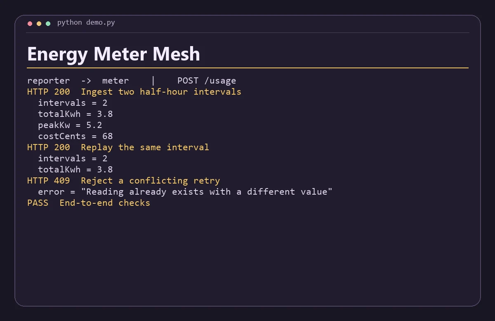

# Energy Meter Mesh

Ingest interval readings into a SQLite-backed meter service and compare site energy use through a separate reporting API.



## Run the demo

Install Python 3.11+, Node.js 22+, then run this from the repository root.

```sh
python demo.py
```

The command starts both services on separate loopback ports, sends the requests in `examples.json`, checks the responses, and shuts down the processes. Use `python3` if that is how your system exposes Python.

## Run the services with Docker Compose

```sh
docker compose up -d --build
python demo.py --base-url http://127.0.0.1:8080
docker compose down
```

The API binds to loopback on port 8080 by default. Set `DEMO_PORT` and use the matching base URL to run another project alongside it. Set-up and service discovery follow the [Docker Compose networking documentation](https://docs.docker.com/compose/how-tos/networking/).

The worker owns the SQLite database. Compose keeps it in the `service-data` volume. Run `docker compose down -v` to reset that project's demo data. A native demo uses a temporary database. Start from fresh demo state before rerunning the scripted Compose checks.

## Architecture

Meter deduplicates half-hour readings by site and timestamp in SQLite. Reporter computes usage totals, peak intervals and estimated cost from the resulting site series.

| Service | Runtime | Operation |
| --- | --- | --- |
| `reporter` | JavaScript | Public demo API, `POST /usage` |
| `meter` | Python | Internal service, `POST /readings` |

The two services exchange JSON over HTTP. Each has a `GET /health` endpoint for process readiness. Compose starts the API after the internal service passes its readiness probe. A gateway request returns HTTP 502 when its dependency is unavailable or fails unexpectedly. Invalid input returns HTTP 400. Domain conflicts return HTTP 409 where supported.

## API example

Send site, rateCents, and zero or more readings with start (ISO UTC, half-hour aligned) and wh (integer watt-hours). The full saved history for that site contributes to the response. Rate is illustrative and excludes fixed charges.

From a running Compose stack, save this JSON as `input.json` and run the command below. On Windows use `curl.exe` if your shell aliases `curl`.

```json
{
  "site": "Studio",
  "rateCents": 18,
  "readings": [
    {
      "start": "2026-11-11T15:00:00Z",
      "wh": 1200
    },
    {
      "start": "2026-11-11T15:30:00Z",
      "wh": 2600
    }
  ]
}
```

```sh
curl -s -H "Content-Type: application/json" --data-binary @input.json http://127.0.0.1:8080/usage
```

The response includes these fields.

```json
{
  "intervals": 2,
  "totalKwh": 3.8,
  "peakKw": 5.2,
  "costCents": 68
}
```

## Scope

This is a local portfolio project using synthetic data. The APIs are intended for loopback and the private Compose network. A public deployment would need authentication, rate limits, and production observability.
